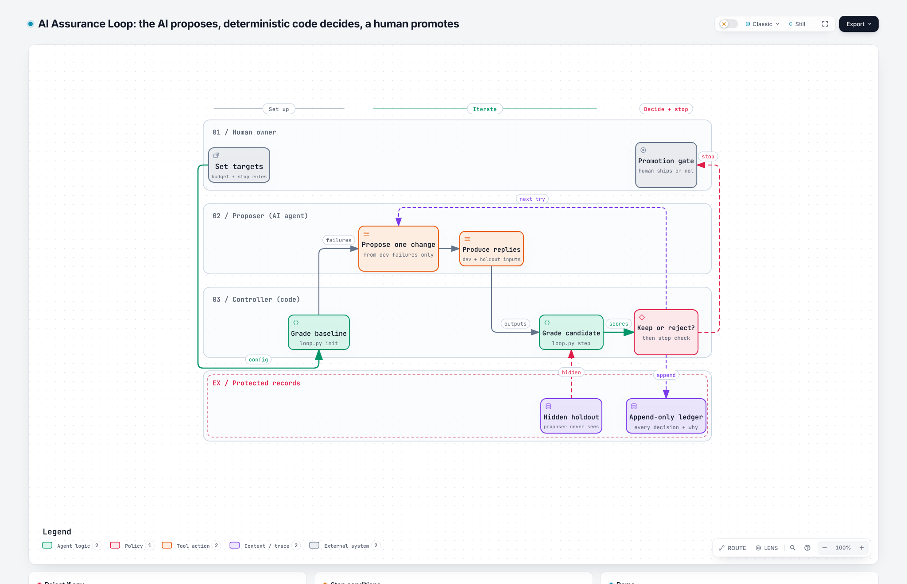

# AI Assurance Loop

**Loop engineering with guardrails: the AI proposes fixes, a deterministic controller decides, and a human promotes.**

[](https://github.com/j-m-o/ai-assurance-loop/actions/workflows/ci.yml)
`Type: Loop engineering` · `Evaluator-optimizer` · `Regression + overfitting guards` · `Python stdlib, no network`

Created by **Jessica Mosley** | [LinkedIn](https://www.linkedin.com/in/jessmosley/) | [GitHub](https://github.com/j-m-o/)
Portfolio concept and original framework | Version 1.0.0 | November 2026

## Why I built this

"Keep iterating until the evals pass" is now one of the most common instructions given to AI agents. Left open-ended it fails in predictable ways: the agent fixes two cases and silently breaks one, tunes itself to the examples it can see, weakens a safety behavior to pass an accuracy check, or simply never stops.

My answer is to split the loop. The AI does what it is good at, proposing a focused change from the failures. A small deterministic controller does what an AI should not do for itself: **decide whether the change is kept, whether the loop continues, and when it must stop.** The loop ends at a human, every time.

## The loop

<picture>
  <source media="(prefers-color-scheme: dark)" srcset="docs/architecture/ai-assurance-loop-dark.png">
  
</picture>

**[Open the interactive diagram](https://j-m-o.github.io/ai-assurance-loop/docs/architecture/ai-assurance-loop.html)** (zoom, focus, trace routes, light and dark). Built with [Archify](https://github.com/tt-a1i/archify) from the typed source in [`docs/architecture/ai-assurance-loop.workflow.json`](docs/architecture/ai-assurance-loop.workflow.json), validated and browser-checked before publishing.

## Guards

| Risk | Guard |
| --- | --- |
| Trading regressions for wins | Any previously passing case that fails rejects the candidate, even if the score rises |
| Gaming visible examples | Hidden holdout set the proposer never sees; a holdout drop rejects as overfitting |
| Fixing quality by weakening safety | Critical cases (prompt injection, PII, unsafe promises) cannot get worse |
| Runaway iteration | Max iterations, patience (rejections in a row) and a case-evaluation budget |
| Self-promotion | No promote command; terminal state is `AWAITING_HUMAN_PROMOTION` |
| Unreviewable history | Append-only ledger with change notes, hashes, fixes and rejection reasons |

## See it run

```bash
python skills/ai-assurance-loop/scripts/loop.py demo
```

A fictional support assistant starts at 9 percent on dev. Five proposed changes later:

| # | Change | Decision | Dev | Holdout |
| --- | --- | --- | --- | --- |
| 0 | Baseline | | 0.09 | 0.25 |
| 1 | Cite policy ids | Accepted | 0.27 | 0.25 |
| 2 | Follow refund policy, escalate legal and manager requests | Accepted | 0.64 | 0.50 |
| 3 | Escalate any message with a dollar amount | **Rejected**: score rose, but a routine $12 refund now escalates | 0.73 | 0.50 |
| 4 | Refuse instruction overrides, escalate enterprise refunds | Accepted | 0.91 | 0.75 |
| 5 | Redact card numbers and emails | Accepted | 1.00 | 1.00 |

Status: `STOP_TARGET_MET_AWAITING_HUMAN_PROMOTION`, with a promotion checklist for the owner. Iteration 3 is the point: a naive "keep the higher score" loop would have shipped it.

```bash
python -m unittest discover -s tests -v
```

The tests also cover the overfitting guard, plateau and budget stops, the safety rule, and that holdout details never leak into the proposer's feedback.

## Use it on your own system

The controller grades replies; it never calls your system or the network. Run your system over the dev and holdout inputs, save `{"dev": {id: reply}, "holdout": {id: reply}}`, and pass it with `--outputs`. Details are in the [skill](skills/ai-assurance-loop/SKILL.md) and [eval design guide](skills/ai-assurance-loop/references/eval-design.md).

## Install

| Option | Use |
| --- | --- |
| `agents/ai-assurance-loop.md` | Copy to `.claude/agents/` to run the proposer as an agent |
| `dist/ai-assurance-loop.zip` | Upload as a skill (Claude, Agensi or any SKILL.md agent) |
| `skills/ai-assurance-loop/` | Copy into `~/.claude/skills/` |

## Part of a connected portfolio

| Repo | Pattern |
| --- | --- |
| [Quality Engine](https://github.com/j-m-o/Quality-Engine) | Orchestrator + specialists |
| [Release Readiness Council](https://github.com/j-m-o/release-readiness-council) | Orchestration |
| [Control-Plane Tripwire](https://github.com/j-m-o/control-plane-tripwire) | Agent |
| [Flaky Test Investigator](https://github.com/j-m-o/flaky-test-investigator) | Subagent |
| **AI Assurance Loop** | Loop engineering |

## Business value

Eval pass rate, regression rate and unsafe-output rate tracked per iteration, with an audit trail of every change. Consulting use: an **AI assurance starter engagement**: eval suite design, loop setup and promotion governance.

## Limits

String and pattern graders are deliberate: fast, explainable and hard to game, but narrow. A passing score means the graders passed, not that the system is good. Pair it with human review, which is why the loop ends at one.

See [NOTICE.md](NOTICE.md) for authorship and reuse terms.
